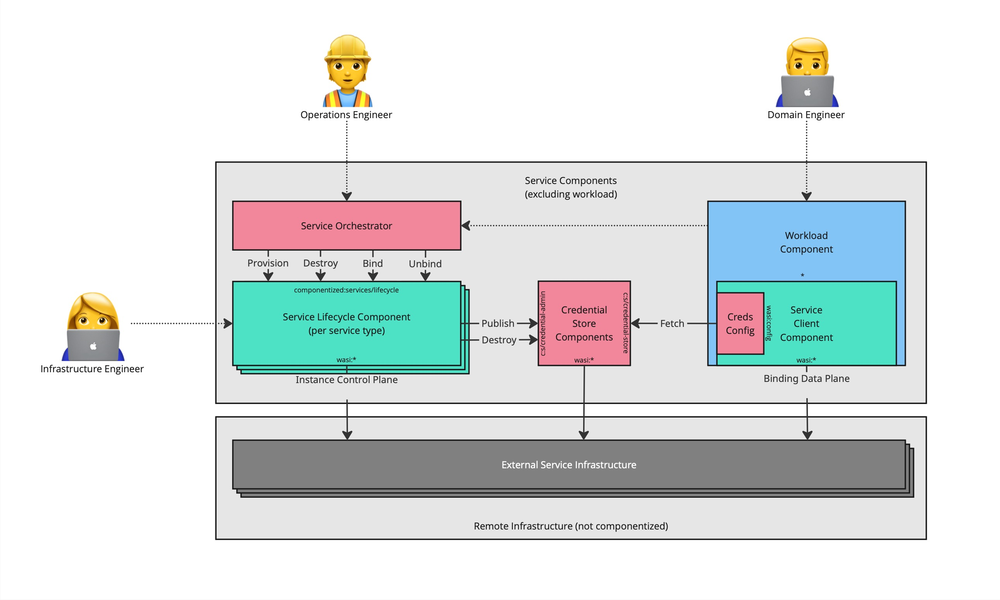

# Services Components <!-- omit in toc -->

A WASM component services lifecycle.

- [Architecture](#architecture)
- [Build](#build)
- [Run](#run)
- [Community](#community)
  - [Code of Conduct](#code-of-conduct)
  - [Communication](#communication)
  - [Contributing](#contributing)
- [Acknowledgements](#acknowledgements)
- [License](#license)

## Architecture

[](./architecture.jpg)

## Build

The components are built with the [componentized build](https://github.com/componentized/build), synced into [`build/`](./build), which installs the tools it needs.

A [dev container](https://containers.dev) is available that contains the necessary tools and configuration out of the box.

Prereqs:
- a rust toolchain, with the targets in [`rust-toolchain.toml`](./rust-toolchain.toml)
- `make` and `jq`
- [`cargo binstall`](https://github.com/cargo-bins/cargo-binstall), optional, to install prebuilt tools

```sh
make
```

builds the interface and each component into `target/components`, and runs the tests. Most components are built for `wasm32-unknown-unknown`, the filesystem components, the valkey lifecycle and the test cli for `wasm32-wasip2`, named in their `Cargo.toml`. Components prefixed with `test-` are for the tests, `dep-` are pulled from other repositories, and `internal-` are composed into other components, none of them are published.

## Run

Prereqs:
- build the components (see above)
- [Docker](https://www.docker.com), to run a [Valkey](https://valkey.io) server

```sh
make test-integration
```

runs the services cli, [`test-cli`](./components/test-cli/), through the lifecycle of a `filesystem` service with `make test-filesystem`, and of a `valkey` service with `make test-valkey`, against a Valkey server in a container.

## Community

### Code of Conduct

The Componentized project follow the [Contributor Covenant Code of Conduct](./CODE_OF_CONDUCT.md). In short, be kind and treat others with respect.

### Communication

General discussion and questions about the project can occur in the project's [GitHub discussions](https://github.com/orgs/componentized/discussions).

### Contributing

The Componentized project team welcomes contributions from the community. A contributor license agreement (CLA) is not required. You own full rights to your contribution and agree to license the work to the community under the Apache License v2.0, via a [Developer Certificate of Origin (DCO)](https://developercertificate.org). For more detailed information, refer to [CONTRIBUTING.md](CONTRIBUTING.md).

## Acknowledgements

This project was conceived in discussion between [Mark Fisher](https://github.com/markfisher) and [Scott Andrews](https://github.com/scothis).

## License

Apache License v2.0: see [LICENSE](./LICENSE) for details.
